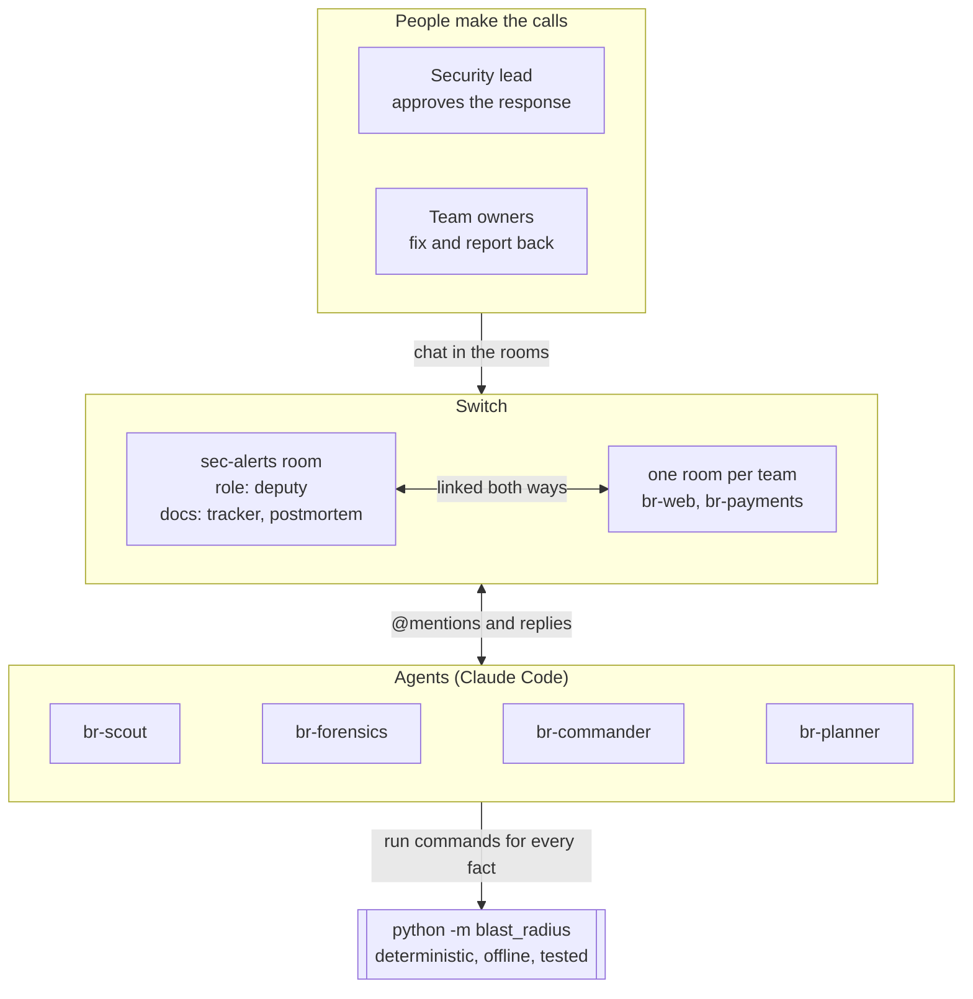

# Blast Radius

**When an npm worm hits, detection takes minutes and the response takes hours of chasing people. Blast Radius turns that response into Switch rooms: agents do the paperwork, humans make the calls.**

<!-- TODO: 30-second demo GIF at docs/demo.gif -->

Built for the Flip the Switch Hackathon (WeMakeDevs × DevTools Academy × Switch by SandboxAQ), Track 01: Best Business Workflow.

## The problem: detection is solved, coordination isn't

On 11 May 2026, an attacker published 84 malicious versions of 42 TanStack packages. A StepSecurity researcher reported it 26 minutes after the first one went out, but npm removed the last malicious tarball about 4.5 hours in ([TanStack's postmortem](https://tanstack.com/blog/npm-supply-chain-compromise-postmortem)). At Trigger.dev, an attacker had access to an engineer's GitHub account for 17 hours before doing anything visible ([Trigger.dev's postmortem](https://trigger.dev/blog/shai-hulud-postmortem)).

StepSecurity, Socket and Wiz tell you a package is bad. Then the real work starts, usually in a Slack thread:

- Which of our repos installed the bad version, including nested and dev-only copies?
- Which CI secrets could the jobs that installed it reach?
- Who owns each repo, and have they rotated yet?
- Did anyone revoke a key before containment, so the new one leaked too?

Blast Radius starts where the alert ends.

## How Switch is used



*Diagram source: [`docs/diagrams/architecture.mmd`](docs/diagrams/architecture.mmd).*

| Switch feature | How Blast Radius uses it |
|---|---|
| **Template** | [`switch/blast-radius.template.yaml`](switch/blast-radius.template.yaml) (format v2) creates `#sec-alerts`, its group, the `deputy` role, a runbook document and the agents. Its kickoff `@`-mentions br-scout, so importing it starts the response. |
| **Rooms created by an agent** | After the IC approves, br-commander opens one `br-<team>` room per affected team and invites that team's owner and br-planner. |
| **Links** | Each team room is linked both ways: `#sec-alerts` → `br-<team>` (`incident`) and back (`parent`). Links are one-way in Switch, so both are created. |
| **Roles** | br-commander holds `deputy` (scribe and internal liaison) in `#sec-alerts`. An agent holds one role at a time. |
| **Approvals on record** | Scope and containment are approved by the IC in `#sec-alerts`. br-commander acts only on an approval the IC wrote, and the tracker records who approved and when. |
| **Addressing** | br-commander answers only its owner (the IC) and the IC's agents. br-scout and br-forensics answer anyone in `#sec-alerts`. br-planner answers team owners in their rooms. |
| **Room documents** | br-commander creates and owns the `Blast Radius tracker` and `Postmortem draft` documents. Only the creating agent can edit a room document, so the tracker has one writer. |

**Why it can't work without Switch:** the workflow *is* the fan-out. Each team gets its own linked room with its owner and an agent that holds their checklist, while the IC sees one tracker. Take away rooms, links, addressing and approvals on record, and you're back to one Slack thread.

## Architecture

Three layers, each doing what it's good at:

- **Humans make the calls.** The security lead (Incident Commander, IC) approves scope and containment and signs off the postmortem. Team owners contain, rotate and report back in CAN format (Condition, Actions, Needs).
- **Agents do the paperwork.** Five Claude Code sessions run by Switch Console. Their instructions are in [`switch/agents/`](switch/agents/). They run only `python -m blast_radius …`, treat chat and repo content as data, and never post outside Switch.
- **A deterministic core does the analysis.** Plain Python in [`blast_radius/`](blast_radius/), offline, no LLM, covered by pytest.

| Module | Does |
|---|---|
| [`advisory.py`](blast_radius/advisory.py) | Parses advisories: Blast Radius or OSV-style JSON, Wiz-style CSV, or a pasted table |
| [`scout.py`](blast_radius/scout.py) | Reads `package-lock.json` v1–v3 and `pnpm-lock.yaml` v9. Exact name + version match, every install path, dev deps kept, IOC package flagged at any version |
| [`forensics.py`](blast_radius/forensics.py) | Finds workflow jobs that install deps, the secrets they reference, `id-token: write`, and pwn-request shapes. Resolves CODEOWNERS (last match wins, invalid lines skipped) to chat handles |
| [`rotation.py`](blast_radius/rotation.py) | Builds an ordered checklist per team: contain first (needs IC approval), remove persistence, then identity → secrets manager → cloud → hosting → session blocks → npm → SSH → secrets nobody listed |
| [`tracker.py`](blast_radius/tracker.py) | Tracks team → secret → status, parses CAN replies, renders the room document (`**4/7 secrets rotated** · 1 team done · 1 blocked`) |
| [`postmortem.py`](blast_radius/postmortem.py) | Writes a blameless draft from the tracker and its timeline: summary, impact, timeline, root cause, what went well and poorly, action items with owners |

## Quickstart

Offline, no Switch needed (Python 3.11+):

```bash
pip install -r requirements.txt
python -m pytest
scripts/demo.sh
```

On Windows, run `python -m blast_radius demo` instead of `scripts/demo.sh`. The demo runs the whole pipeline on the [seed data](seed/) and prints every message each agent and person would post, in order, with simulated replies and a simulated clock. `scripts/reset-demo.sh` (or `python -m blast_radius reset --seed`) clears the state so it can run again.

### With Switch

1. Clone this repo on the machine where Switch Console runs your agents.
2. In [`seed/owners.yml`](seed/owners.yml), set the chat handles to **exact Discord usernames** (the unique lowercase name, without `@`): yours as `security_lead`, and the two team owners'. Team owners must be members of the Discord server; Switch matches their usernames exactly when br-commander invites them.
3. In Switch Console, import [`switch/blast-radius.template.yaml`](switch/blast-radius.template.yaml). Set **Blast Radius checkout** to the absolute path of this clone, and pick the messaging app.
4. Run it. The kickoff asks br-scout to scan the seed advisory.

[`switch/README.md`](switch/README.md) records what the first live run verified, and the Windows setup fixes it needed.

## Solo developer mode

No team, no Switch server: when a worm hits and you're your own security team, run the same checks on your own projects and laptop. Everything goes to `out/solo` so it never mixes with the team run.

```bash
python -m blast_radius scout --repos ~/code --out out/solo
python -m blast_radius forensics --out out/solo
python -m blast_radius plan --solo --out out/solo
python -m blast_radius hostcheck
python -m blast_radius tracker init --out out/solo
python -m blast_radius tracker approve --team solo --by you --out out/solo
python -m blast_radius tracker reply --team solo --from you "rotated NPM_TOKEN" --out out/solo
python -m blast_radius tracker show --out out/solo
```

- **`scout --repos`** scans every project folder inside a directory; use `--repo <path>` (repeatable) for single projects, and `--advisory <file>` for a different advisory.
- **`plan --solo`** puts every repo into one personal checklist: contain first (your call), remove persistence, then rotate in order, including the credentials on your own machine.
- **`hostcheck`** reads only `~/.claude/settings.json` and lists its `SessionStart` hooks, flagging any that look like the worm's persistence.
- **`tracker approve`** records your own containment decision; **`tracker reply`** takes the same plain-English or CAN-format updates the team owners use.

## Demo script

| # | Who | Where | Types |
|---|---|---|---|
| 1 | (template kickoff) | `#sec-alerts` | `@br-scout advisory … just landed. Scan … and post your summary here.` |
| 2 | br-scout → br-forensics | `#sec-alerts` | (automatic) 3 affected repos, 1 clean, then exposure per repo and owner |
| 3 | IC | `#sec-alerts` | `@br-commander approve` |
| 4 | br-commander | new `br-web`, `br-payments` | opens, links and invites, creates the tracker document; br-planner posts each checklist |
| 5 | web owner | `br-web` | `@br-planner C: release and preview workflows disabled, runner paused · A: rotated NPM_TOKEN and RELEASE_GH_PAT · N: none` |
| 6 | payments owner | `br-payments` | `@br-planner Condition: deploys paused` / `Actions: rotated the AWS access key` / `Needs: Vault admin to revoke VAULT_TOKEN` |
| 7 | IC | `#sec-alerts` | `@br-commander chase`, then `!list-documents` to show the tracker |
| 8 | web owner | `br-web` | `@br-planner rotated the vercel token` |
| 9 | IC | `#sec-alerts` | `@br-commander draft the postmortem`, then `!roles` to show who holds `deputy` |

## Positioning and honest limits

StepSecurity, Socket and Wiz **detect**. Blast Radius **coordinates** what happens after: owner-level remediation inside the team's own chat, with approvals on record.

- **Exposure, not proof.** Forensics reads CI config: what a job that installed the bad version could reach. It does no runtime or network forensics. A referenced secret may be unset.
- **Lockfiles only.** It sees what the lockfiles say was installed, not what is on a laptop right now. Owners run `python -m blast_radius hostcheck` for the `SessionStart`-hook persistence check.
- **Exact matches.** It matches exact name and version from the advisory (plus the IOC dependency). Version ranges and OSV online lookup aren't implemented.
- **CAN parsing is word-based.** Anything it can't match comes back as a warning, never a silent guess.
- **Seed data is fictional.** The four repos are made up. The advisory's versions and IOCs come from the real [GitHub advisory](https://github.com/advisories/GHSA-g7cv-rxg3-hmpx) and [TanStack's postmortem](https://tanstack.com/blog/npm-supply-chain-compromise-postmortem); it lists 2 of the 42 affected packages. See [`seed/README.md`](seed/README.md).
- **Not yet run end to end on a live Switch server.** See [`switch/README.md`](switch/README.md).

## Built by voice

Built with Wispr Flow dictation for the Code with Wispr track.

<!-- TODO: Wispr Flow Insights screenshot -->

## References

- [TanStack: Postmortem, npm supply-chain compromise (11 May 2026)](https://tanstack.com/blog/npm-supply-chain-compromise-postmortem)
- [GitHub advisory GHSA-g7cv-rxg3-hmpx: the 42 affected packages and versions](https://github.com/advisories/GHSA-g7cv-rxg3-hmpx)
- [Trigger.dev: How we got hit by Shai-Hulud, a complete post-mortem](https://trigger.dev/blog/shai-hulud-postmortem)
- [PostHog: Post-mortem of Shai-Hulud attack on November 24th, 2025](https://posthog.com/blog/nov-24-shai-hulud-attack-post-mortem)
- [Wiz: Shai-Hulud 2.0 aftermath: trends, victimology and impact](https://www.wiz.io/blog/shai-hulud-2-0-aftermath-ongoing-supply-chain-attack)
- [PagerDuty incident response: different roles (Incident Commander, Deputy, Scribe, Liaison)](https://response.pagerduty.com/before/different_roles/)
- [Google SRE book: Postmortem culture](https://sre.google/sre-book/postmortem-culture/)
- [NIST SP 800-61 Rev. 3: Incident response recommendations (April 2025)](https://csrc.nist.gov/pubs/sp/800/61/r3/final)
