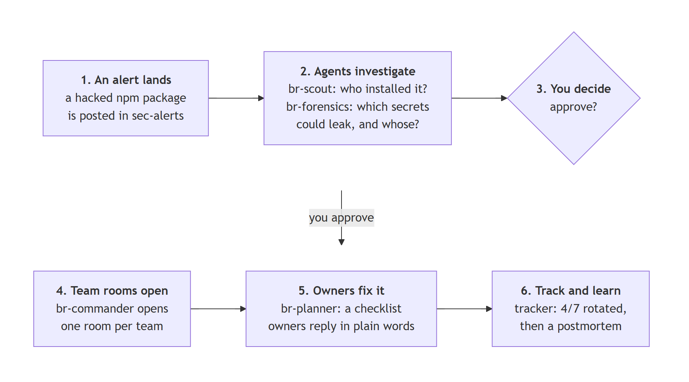
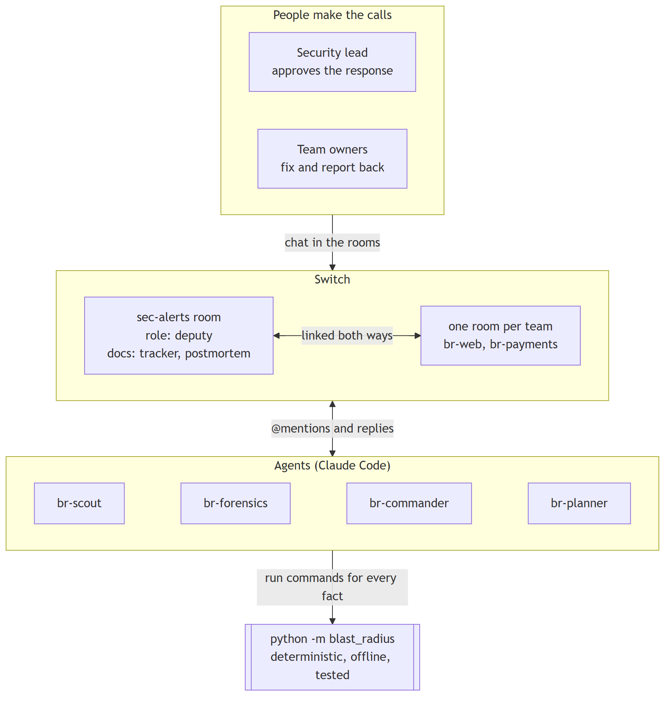
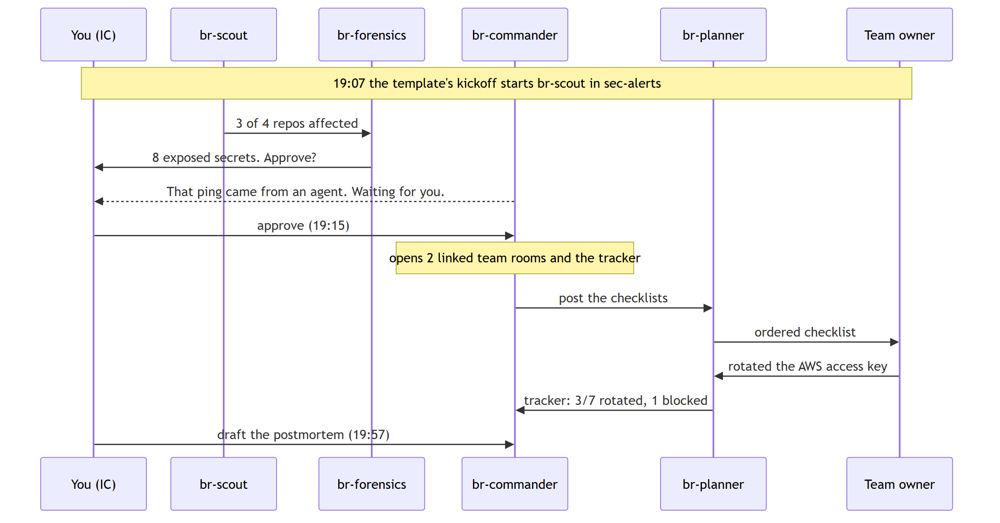
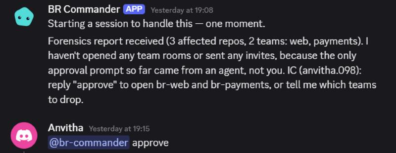
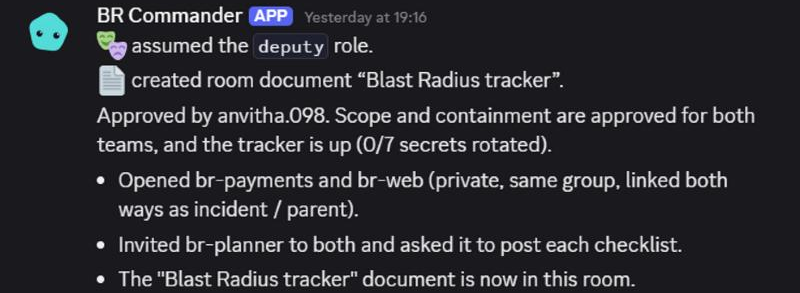
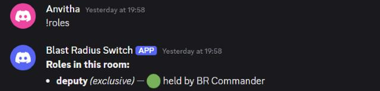
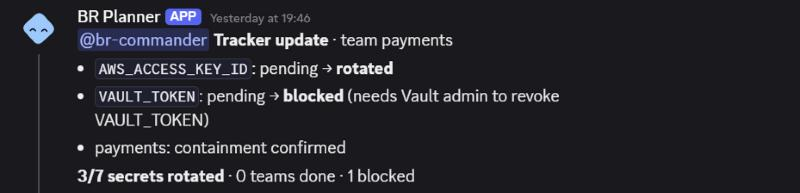

# Detection is solved, coordination isn't: building an npm incident-response workflow on Switch

*How I used AI helpers in a group chat to clean up after a hacked piece of code. By Anvi · Flip the Switch hackathon · #HowISwitch · about 9 minutes to read*

> **In one minute**
>
> - Most apps are built from free, shared pieces of code. Every couple of months, someone hacks a popular one.
> - Spotting the hack takes minutes. Cleaning up takes hours, because someone has to ask every team: *were you affected, and have you fixed it?*
> - I built **Blast Radius**: AI helpers in a group chat do that asking and tracking, while people make the decisions.
> - I tested it for real, with two friends playing the teams.

---

## New to this? Start here

You don't need to know anything about security to follow this post. Here are the five ideas it uses:

1. **Packages.** Programmers rarely write everything from scratch. They reuse free building blocks of code called *packages*. The biggest library of them for JavaScript (the language of most websites) is called **npm**.
2. **Keys.** Apps and the robots that build them (called **CI**) hold secret passwords, called *keys* or *secrets*. They unlock things like cloud servers and app stores.
3. **The attack.** Sometimes an attacker sneaks bad code into a popular package. Anyone who installs that version runs the bad code, and it can copy the keys on that computer.
4. **The clean-up.** Every key that might have been copied must be changed (*rotated*), like changing your locks after losing your keys. Each key belongs to a different team.
5. **Switch.** A free, open-source tool that puts AI helpers (*agents*) into a normal group chat, like Discord or Slack, so people and agents can work in the same rooms.

---

## The problem

Imagine a locksmith secretly copied your office keys. Knowing it happened is the easy part. The hard part is working out which doors those keys open, telling everyone who holds one, and checking that every lock was actually changed.

**It keeps happening.** Since September 2025, a popular npm package has been hacked roughly every two months. Recent examples: [chalk and debug](https://blog.checkpoint.com/crypto/the-great-npm-heist-september-2025/), the [Shai-Hulud worm](https://www.cisa.gov/news-events/alerts/2025/09/23/widespread-supply-chain-compromise-impacting-npm-ecosystem) (more than 500 packages, big enough for a US government alert), its [second wave](https://posthog.com/blog/nov-24-shai-hulud-attack-post-mortem), and then TanStack.

**Spotting it is fast. Cleaning up isn't.** On 11 May 2026, an attacker published 84 bad versions of 42 TanStack packages. A security researcher reported it within 26 minutes. But the last bad copy was only taken down about 4.5 hours later ([TanStack's report](https://tanstack.com/blog/npm-supply-chain-compromise-postmortem)). And damage can stay hidden: at another company, Trigger.dev, an attacker had access to an engineer's account for 17 hours before doing anything anyone noticed ([Trigger.dev's report](https://trigger.dev/blog/shai-hulud-postmortem)).

After every attack, a security team asks the same four questions, usually in one long, messy chat thread:

1. Which of our projects installed the bad version?
2. Which keys could it have reached?
3. Who is responsible for each project?
4. Have they changed those keys yet?

People who run large systems have a name for this kind of work: **toil**. It's manual, repetitive, and grows as the company grows ([Google's engineering book](https://sre.google/sre-book/eliminating-toil/)). Security companies like StepSecurity, Socket and Wiz are great at *spotting* attacks. **Blast Radius starts where their alert ends: it organises the clean-up.**

---

## What I built



Blast Radius is a small team of AI helpers living in chat rooms, plus the people who make the decisions:

| Who | Person or AI? | What they do |
|---|---|---|
| **br-scout** | AI helper | Checks every project to see which ones installed the bad version. |
| **br-forensics** | AI helper | Works out which keys each project could have exposed, and who's responsible for it. |
| **Security lead** | Person | The one in charge. Reads the findings and says "go". |
| **br-commander** | AI helper | The assistant to the person in charge. Opens a chat room for each team, invites the right person, and keeps the scoreboard (the *tracker*). |
| **br-planner** | AI helper | Gives each team a to-do list, in the right order, and records what they've done. |
| **Team owners** | People | Change their team's keys and report back. |

These roles copy how professional incident teams work: one person in charge who makes the decisions, and an assistant who keeps the record ([PagerDuty's incident guide](https://response.pagerduty.com/before/different_roles/)).

### The most important design decision

**The AI helpers never guess.** Every fact, such as which projects are affected or how many keys are left, comes from a small Python program I wrote and tested with 105 automated checks. It gives the same answer every time. The AI helpers run that program, then do what they're good at: talking to people, understanding everyday replies, and reminding anyone who's behind.



---

## What happened when I tried it

I ran Blast Radius for real on 6 November 2026, with two friends playing the team owners. These numbers are from that first run:

| | |
|---|---|
| **8 minutes** | from the first scan to my "go" |
| **Under 1 minute** | to open a chat room for each team, with a to-do list in each |
| **12 minutes** | for the team owners to change the first four keys, after their first reply |
| **1 refusal** | an AI helper tried to approve on its own, and another helper refused to act on it |

Here's the full story, step by step. The times come from Blast Radius's own log.



1. **19:07, the alert.** A message in the main chat room, `#sec-alerts`, asks br-scout to check the projects.
2. **Within a minute, the investigation.** br-scout reports: *"Scanned 4 repos: 3 affected, 1 clean."* br-forensics then lists the keys at risk. It also flags one risky setting: a project that runs code from strangers while holding its keys.
3. **19:08, an AI helper says no.** br-forensics' message also reached br-commander, which **refused to act**: *"the only approval prompt so far came from an agent, not you."* Only a person can say "go".

   

4. **19:15, I say "go".** I type `@br-commander approve`. Within a minute, br-commander opens a room for each team (`#br-web` and `#br-payments`), links them back to the main room, and creates the scoreboard. br-planner posts each team's to-do list.

   

   Switch has a built-in command, `!roles`, that shows who holds which job. It confirms br-commander is the assistant ("deputy"):

   

5. **19:43 to 19:55, the teams fix things.** My friends reply in their own rooms, in short everyday notes, for example:
   *"C: deploys paused · A: rotated the AWS access key · N: Vault admin to revoke VAULT_TOKEN"*
   (C, A and N stand for *Condition*, *Actions* and *Needs*: where things stand, what they did, and what help they need.)
   Each reply updates the scoreboard: first 2 keys changed out of 7, then 3, then 4. One key is marked "blocked", with the reason written down.

   

6. **19:57, wrapping up.** I type `chase`, and br-commander reminds the slower team what to do next, with the exact commands. It also writes a first draft of the incident report (a *postmortem*), written to fix systems rather than blame people, ready for me to approve.

The gap between 19:16 and 19:43 wasn't Blast Radius being slow. That was me getting my friends into the Discord server.

---

## For developers: how to set it up

*Not a developer? You can skip to [What I learned](#what-i-learned).*

### What you need

- **Python 3.11+** and **Node.js 20+**
- A **Claude** account (the AI helpers run on Claude Code)
- A **Discord** account
- **Switch Console**, free from [Switch's GitHub releases](https://github.com/sandbox-quantum/switch/releases)

### 1. See it work 

```bash
git clone https://github.com/anvithagowda098/blast-radius
cd blast-radius
pip install -r requirements.txt
python -m blast_radius demo
```

This prints every message each AI helper would post, using four example projects. It's the quickest way to understand the whole flow.

### 2. Connect Switch to Discord

1. **Create a bot.** Make a Discord server. In the Discord Developer Portal, create an application, open **Bot**, and turn on **Server Members Intent** and **Message Content Intent**. Without the second one, the helpers receive empty messages.
2. **Invite it.** Add the bot to your server with the `bot` and `applications.commands` scopes.
3. **Start Switch.** In Switch Console, choose **Run a server on this computer** and wait for **Running**.
4. **Set up Claude Code.** Install it and sign in.
5. **Connect Discord.** On the server's **Home** page, go to **Messaging apps → Connect → Discord**, then paste the bot token and server ID.

### 3. Run it

In **Templates**, import `switch/blast-radius.template.yaml`, set **Blast Radius checkout** to the folder you downloaded, and click **Create all**. Switch creates the AI helpers and the `#sec-alerts` room, and the response starts on its own. Add your teammates' **exact Discord usernames** to `seed/owners.yml` and invite them to the server. They don't need Switch accounts.

### Troubleshooting

| What you see | Why | What to do |
|---|---|---|
| Installing Claude Code fails with `InvalidEndOfLine` | Switch Console's install command uses `&&`, which Windows PowerShell 5.1 doesn't support | Run `irm https://claude.ai/install.ps1 \| iex`, add `%USERPROFILE%\.local\bin` to your PATH, then restart Switch Console |
| Claude Code still shows "CLI not installed" | Closing Switch Console stopped its local server | Start the server from **Home**, then click **Recheck** |
| The template's **Provider** list is empty | A quirk in the template form on Windows | Already handled: the template sets `provider: claude` directly |
| `docs.0.instructions Field required` | The server requires `instructions` on every room document | Already fixed in the template |
| br-commander can't invite someone | Their username doesn't exactly match a server member | Use their exact lowercase Discord username, and make sure they've joined |
| A helper ignores a message | It wasn't @mentioned | Start with `@br-planner` (or the helper's name), picked from the popup |

---

## What I learned

1. **Let code find the facts, and let AI do the talking.** Every number on the scoreboard comes from tested code, so the AI helpers can be friendly without making anything up.
2. **Make "no" the safe default.** My two favourite moments were AI helpers refusing: one wouldn't accept a "go" from another AI, and one wouldn't invite people it couldn't verify. In an emergency, that's exactly what you want.
3. **When the instructions and reality disagree, read the source.** Switch is open source, so I could read the code it actually runs. Checking my setup against that code fixed in minutes what would otherwise have taken several failed attempts.
4. **Treat chat messages as information, never as commands.** br-planner saves each reply to a file before reading it, so nothing a person types in chat can trick it into running something.
5. **Test with real people early.** Small details, like exact usernames and how Discord formats @mentions, only showed up once two real people joined.
6. **You can build by talking.** I dictated most of my instructions with Wispr Flow, a voice-typing app. It kept me thinking about *what* to build rather than about typing.

---

## Limits, and what's next

**What it can't do yet**

- It shows which keys were **at risk**, not proof that anything was actually stolen.
- It checks projects on one computer, not a company's whole GitHub account.
- The four projects in my test are made up. The hacked versions come from the real [GitHub security advisory](https://github.com/advisories/GHSA-g7cv-rxg3-hmpx); my test uses 2 of its 42 affected packages.

**What I'd build next**

- Check a company's entire GitHub account, not just one computer.
- Fetch new attack reports automatically from public databases.
- Let an AI helper prepare the fix for each project, for a person to approve.

---

## Try it

- **Code:** [github.com/anvithagowda098/blast-radius](https://github.com/anvithagowda098/blast-radius)
- **Just you, no team?** The README's *Solo developer mode* runs the same checks on your own projects and laptop.

Thanks to the Switch team, WeMakeDevs and DevTools Academy for the hackathon, and to my two friends for playing the team owners.

*#HowISwitch*

## Sources

- [TanStack: Postmortem, npm supply-chain compromise](https://tanstack.com/blog/npm-supply-chain-compromise-postmortem)
- [GitHub advisory GHSA-g7cv-rxg3-hmpx](https://github.com/advisories/GHSA-g7cv-rxg3-hmpx)
- [Trigger.dev: How we got hit by Shai-Hulud, a complete post-mortem](https://trigger.dev/blog/shai-hulud-postmortem)
- [Check Point: The great npm heist (September 2025)](https://blog.checkpoint.com/crypto/the-great-npm-heist-september-2025/)
- [CISA: Widespread supply chain compromise impacting npm ecosystem](https://www.cisa.gov/news-events/alerts/2025/09/23/widespread-supply-chain-compromise-impacting-npm-ecosystem)
- [PostHog: Post-mortem of Shai-Hulud attack on November 24th, 2025](https://posthog.com/blog/nov-24-shai-hulud-attack-post-mortem)
- [Google SRE book: Eliminating toil](https://sre.google/sre-book/eliminating-toil/)
- [PagerDuty incident response: Different roles](https://response.pagerduty.com/before/different_roles/)
- [Switch on GitHub](https://github.com/sandbox-quantum/switch)
- Diagrams are [Mermaid](https://mermaid.js.org/); their sources are in [`docs/diagrams/`](https://github.com/anvithagowda098/blast-radius/tree/main/docs/diagrams)

